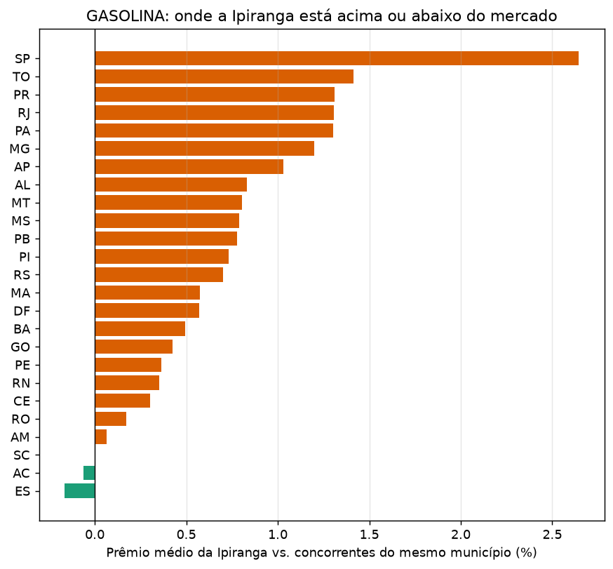

# Radar de Preços de Combustíveis · PySpark + Databricks

> Estudo independente sobre dados públicos da ANP, sem relação com nenhuma distribuidora.
> Bandeira conforme declarada à ANP; as marcas pertencem aos seus titulares.

Pipeline de dados e modelo preditivo sobre a **pesquisa semanal de preços da ANP**: 3 milhões
de coletas de jan/2023 a jun/2026, posto a posto, com a bandeira de cada revenda.

Perguntas de negócio:

1. **Onde a Ipiranga está acima ou abaixo do mercado?** Em cada município e semana, a mediana
   dos postos Ipiranga contra a mediana dos concorrentes do mesmo município.
2. **O preço do município vai subir na semana que vem?** Classificação para antecipar altas de
   pelo menos 0,5% na mediana municipal.
3. **O barril de petróleo ajuda a antecipar essa alta?** O Brent em reais entra como sinal, e o
   modelo é medido com e sem ele.

## Resultados

### Qualidade dos dados

| Etapa | Linhas |
|---|---:|
| Bronze (como veio da ANP) | 3.038.685 |
| Quarentena (linhas `;;;;` vazias no semestre 2025-01) | 9.114 |
| Duplicatas removidas (mesmo posto, produto e dia) | 20 |
| **Silver (válidas)** | **3.029.551** |

Três armadilhas da fonte que o pipeline trata e os testes cobrem: a ANP trocou nomes de bandeira
no meio da série (`VIBRA ENERGIA` → `VIBRA`, `ALESAT` → `ALE`), o semestre 2025-02 grava a unidade
do GNV como `R$ / m3` em vez de `R$ / m³`, e há campos entre aspas com `;` e quebra de linha.

### Prêmio da Ipiranga sobre os concorrentes do mesmo município

| Produto | Municípios | Prêmio no município típico | IC 95% (bootstrap por município) | Acima / igual / abaixo |
|---|---:|---:|---|---|
| Diesel S10 | 405 | +1,0% | +0,7% a +1,6% | 61% / 10% / 29% |
| Diesel | 362 | +1,1% | +0,8% a +1,5% | 61% / 7% / 32% |
| Gasolina aditivada | 392 | +1,0% | +0,8% a +1,4% | 64% / 8% / 27% |
| Etanol | 388 | +0,9% | +0,4% a +1,6% | 61% / 16% / 23% |
| Gasolina comum | 408 | +0,3% | +0,2% a +0,6% | 60% / 18% / 22% |
| GNV | 55 | 0,0% | 0,0% a 0,0% | 38% / 31% / 32% |

O prêmio é pequeno na gasolina comum, o produto mais comparado pelo consumidor, e maior em
diesel e aditivada. Varia muito por estado (em SP passa de 2,5% na gasolina; ES e AC ficam abaixo
do mercado): ver `reports/figuras/premio_uf_*.png`.



### Modelo: alta de ≥ 0,5% na semana seguinte

Teste nas últimas 26 semanas (dez/2025 a jun/2026), nunca usado para escolha alguma. Taxa de alta
no teste: 24%.

| Modelo | ROC AUC | Average precision | Precisão nos 10% mais prováveis |
|---|---:|---:|---:|
| Gradient boosting com o barril em reais | **0,724** | **0,494** | **62%** |
| Gradient boosting sem o barril | 0,690 | 0,382 | 49% |
| Regressão logística sem o barril | 0,683 | 0,437 | 53% |
| Regressão logística com o barril | 0,652 | 0,387 | 46% |
| Persistência (variação da última semana) | 0,518 | 0,300 | 42% |

O "barril em reais" são três features: a variação do Brent × dólar em 1, 4 e 8 semanas, medida até
a semana anterior. Os dois modelos foram treinados de novo sem elas, com a mesma partição, a mesma
semente e os mesmos hiperparâmetros, para medir a diferença.

Leitura honesta:

- **O barril ajuda o boosting.** O AUC sobe de 0,739 para 0,752 na validação e de 0,690 para 0,724
  no teste. Reamostrando semanas inteiras, o ganho é de +0,013 na validação (intervalo de 90%: +0,004
  a +0,024) e de +0,034 no teste (+0,004 a +0,068). No Databricks a mesma comparação deu +0,015 na
  validação (+0,007 a +0,024) e +0,028 no teste (-0,002 a +0,063): o ganho da validação se repete,
  o do teste é positivo mas o intervalo encosta no zero. A decisão de manter a feature se apoia na
  validação. Entre os 10% de mercados mais prováveis, 62% subiram de fato, contra 24% de média.
- **O ganho do teste depende de um episódio.** O teste contém a guerra do Irã: o Brent foi de US$ 70
  a mais de US$ 120 entre fevereiro e março de 2026. Em 12 das 26 semanas do teste a variação de 8
  semanas do barril está fora de tudo o que o treino viu (até +76%, contra +21% no treino), e ali
  uma árvore só repete o que aprendeu na ponta. O ganho da validação, em período calmo, é a
  estimativa conservadora.
- **A logística piora com o barril** (0,683 para 0,652 no teste, e também na validação). O efeito
  não é linear, e por isso a referência linear da tabela é a logística sem o barril. O boosting, que
  antes empatava com ela, agora ganha com folga.
- **O barril diz quando, não onde.** Ele é igual para todos os municípios da semana: aponta as
  semanas e os produtos em que a alta é mais provável, não distingue um município do vizinho. Por
  produto, o AUC no teste com e sem o barril: gasolina aditivada 0,698 e 0,640; gasolina comum 0,698
  e 0,654; diesel S10 0,733 e 0,697; etanol 0,715 e 0,692; diesel 0,759 e 0,738; GNV 0,678 e 0,677.
- **O repasse leva semanas.** A variação nacional da última semana continua sendo o que mais pesa;
  depois vêm a variação local, a dispersão de preços no município e o barril em 4 e 8 semanas. A
  variação do barril em 1 semana quase não pesa. A semana do ano continua atrapalhando: 2,5 anos de
  treino não bastam para aprender sazonalidade.
- **Limites da medida.** Os horizontes de 1, 4 e 8 semanas foram fixados antes de olhar qualquer
  métrica do modelo, mas depois de uma análise exploratória do repasse que usou a série inteira,
  inclusive o período de teste. E a ordem das linhas que sai do Spark muda o boosting na terceira
  casa (cerca de 0,001 de AUC entre execuções idênticas).


## Arquitetura (medallion no Unity Catalog)

```
ANP (zip) ─► Volume UC  /Volumes/workspace/anp/bruto  (descompactado no próprio volume)
                     │
                     ▼
   bronze_precos        texto como veio + arquivo de origem
                     │   regras de qualidade, try_cast (ANSI), deduplicação
                     ▼
   silver_precos        tipado, 1 linha por posto/produto/dia   ─┐
   silver_quarentena    linhas rejeitadas + motivo               │ liquid clustering
                     │                                           │ (produto, semana)
                     ▼                                           │
   gold_mercado_semanal   UF × município × produto × semana     ─┘
   gold_bandeira_semanal  mediana nacional por bandeira
   gold_nacional_semanal  mediana nacional e variações
   gold_features          features + alvo para o modelo  ◄── gold_brent_semanal
                     │
                     ▼
   scikit-learn + SciPy + MLflow   (modelo, métricas, gráficos)

Brent (EIA) e dólar (Banco Central) ─► referencias/*.csv no repositório ─► Volume UC
   bronze_brent, bronze_dolar      texto como veio de cada fonte
   silver_referencias_diarias      1 linha por dia: brent_usd, dolar
   gold_brent_semanal              barril em reais por litro e variações de 1, 4 e 8 semanas
```

O mesmo pacote `src/anp_precos` roda **localmente** e **no Databricks** (Delta no Unity Catalog).
Só a classe `Lago` sabe onde gravar. O CI roda as transformações e o modelo em Linux (testes de
bronze, silver, gold, séries de referência, pipeline de ponta a ponta em memória, gravação em Parquet
e modelo); a execução completa sobre os 3 milhões de linhas foi feita localmente (cerca de 5 minutos
em 8 núcleos, já com o modelo treinado duas vezes para a comparação com e sem o barril) e no
Databricks serverless (notebooks 01 e 02 em cerca de 4 minutos). As contagens de qualidade, as
séries de referência e a regressão logística saem idênticas nos dois ambientes; o gradient boosting
difere na terceira casa.

## Decisões que importam

- **Leitura defensiva:** BOM, `;` como separador, vírgula decimal, campos entre aspas com quebra de
  linha e cabeçalho conferido em cada arquivo (`enforceSchema=false`).
- **ANSI ligado:** Spark 4 e o serverless do Databricks lançam erro em cast inválido. Todo parse
  usa `try_cast`/`try_to_timestamp`, e a linha ruim vai para a quarentena com o motivo, em vez de
  derrubar o job ou virar nulo silencioso.
- **Mediana exata:** `percentile_approx(x, 0.5)` devolve a mediana inferior. Com 2 postos Ipiranga
  a R$ 6,00 e R$ 6,20, ela daria 6,00 e enviesaria o prêmio. Os grupos município × semana são
  pequenos, então o pipeline usa `median`, exata.
- **Semana faltante não é semana anterior:** a ANP não visita todo município toda semana. As
  variações só são calculadas quando a semana anterior existe de fato.
- **Prêmio justo:** a Ipiranga só é comparada com concorrentes do mesmo município e semana, e só
  quando há pelo menos 2 concorrentes. `RAIZEN MIME` conta como Raízen.
- **Validação no tempo:** treino até jun/2025, validação (que também decide o early stopping) até
  dez/2025, teste até jun/2026, com 1 semana de embargo em cada fronteira, porque o alvo da semana
  t usa o preço de t+1. Nada é embaralhado.
- **Barril em reais só com o que a fonte já publicou:** a EIA divulga o Brent spot com cerca de uma
  semana de atraso. Por isso a linha da semana t recebe a variação do barril medida até t-1, que é
  o que o próprio pipeline conseguiria produzir na hora de prever t+1. Com uma cotação em tempo real
  daria para usar a semana t; aqui a escolha foi não medir o modelo com um dado que ele não teria.
- **Semana incompleta não vira média:** a semana só tem barril em reais com pelo menos 3 cotações
  do Brent e 3 do dólar, e a variação só existe contra a semana exata (7, 28 ou 56 dias antes).
- **Série de referência ruim derruba a carga:** linha com coluna a mais ou a menos, texto no lugar de
  número, NaN, valor fora da faixa plausível ou arquivo vazio param o pipeline com a mensagem. Se o
  barril faltar em mais de 10% das semanas do `gold_features`, o gold também falha, em vez de gravar
  a feature nula em silêncio.
- **Estatística sem exagero:** semanas de um mesmo município não são independentes, então o
  intervalo de confiança vem de bootstrap reamostrando municípios inteiros, não do p-valor.
- **Revisão adversarial:** antes de publicar, uma revisão independente procurou quebrar o projeto
  e achou a mediana inferior, os nomes antigos de bandeira, o GNV `m3` e o early stopping com
  amostra aleatória. Todos foram corrigidos e ganharam teste. Na entrada do barril em reais, uma
  segunda revisão achou que a feature usava uma semana que a fonte ainda não teria publicado, que
  `NaN` passava pela validação das séries e que três testes passariam com o código errado. Também
  corrigido antes de publicar.

## Como rodar

### Databricks (Free Edition)

1. *Workspace → Create → Git folder* com a URL deste repositório.
2. Rode `notebooks/00_preparar_unity_catalog`. Suba os zips da ANP (`ca-AAAA-SS.zip`) em
   *Catalog → workspace → anp → Volumes → bruto* e rode a última célula do notebook 00. O Brent e o
   dólar não precisam de upload: o notebook copia `referencias/*.csv` do repositório para o volume.
3. Rode `01_bronze_silver_gold` e depois `02_analise_e_modelo`.

### Local

```bash
python -m venv .venv && .venv/Scripts/activate      # Java 17 instalado
pip install -r requirements.txt
pytest
python scripts/rodar_local.py --origem data/raw/csv  # CSVs da ANP descompactados nessa pasta
python scripts/baixar_referencias.py                 # opcional: atualiza Brent e dólar em referencias/
```

No Windows o script usa `--modo memoria` (checkpoint em memória), porque o Spark só grava em disco
no Windows com o `winutils.exe` do Hadoop. Em Linux e macOS o padrão é `--modo parquet`.

## Fonte

- [ANP · Série histórica de preços de combustíveis](https://www.gov.br/anp/pt-br/centrais-de-conteudo/dados-abertos/serie-historica-de-precos-de-combustiveis),
  dados abertos. Esses arquivos não estão no repositório (`data/` no `.gitignore`).
- Brent spot (Europe Brent FOB, US$/barril): U.S. Energy Information Administration, pela série
  [DCOILBRENTEU do FRED](https://fred.stlouisfed.org/series/DCOILBRENTEU).
- Dólar PTAX de venda: Banco Central do Brasil, [série 1 do SGS](https://www3.bcb.gov.br/sgspub/).

As duas séries de referência somam cerca de 100 KB e ficam versionadas em `referencias/`, como
vieram das fontes, para o pipeline rodar igual na máquina local, no CI e no Databricks.
