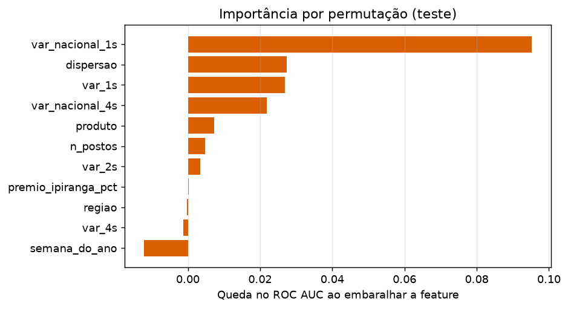

# Radar de Preços de Combustíveis · PySpark + Databricks

> Estudo independente sobre dados públicos da ANP, sem relação com nenhuma distribuidora.
> Bandeira conforme declarada à ANP; as marcas pertencem aos seus titulares.

Pipeline de dados e modelo preditivo sobre a **pesquisa semanal de preços da ANP**: 3 milhões
de coletas de jan/2023 a jun/2026, posto a posto, com a bandeira de cada revenda.

Perguntas de negócio:

1. **Onde a Ipiranga está acima ou abaixo do mercado?** Em cada município e semana, a mediana
   dos postos Ipiranga contra a mediana dos concorrentes do mesmo município.
2. **O preço do município vai subir na semana que vem?** Classificação para antecipar altas de
   pelo menos 0,5% na mediana municipal.

## Resultados

### Qualidade dos dados

| Etapa | Linhas |
|---|---:|
| Bronze (como veio da ANP) | 3.038.685 |
| Quarentena (linhas `;;;;` vazias no semestre 2025-01) | 9.114 |
| Duplicatas removidas (mesmo posto, produto e dia) | 20 |
| **Silver (válidas)** | **3.029.551** |

Três armadilhas da fonte que o pipeline trata e os testes cobrem: a ANP trocou nomes de bandeira
no meio da série (`VIBRA ENERGIA` → `VIBRA`, `ALESAT` → `ALE`), o semestre 2025-02 grava a unidade
do GNV como `R$ / m3` em vez de `R$ / m³`, e há campos entre aspas com `;` e quebra de linha.

### Prêmio da Ipiranga sobre os concorrentes do mesmo município

| Produto | Municípios | Prêmio no município típico | IC 95% (bootstrap por município) | Acima / igual / abaixo |
|---|---:|---:|---|---|
| Diesel S10 | 405 | +1,0% | +0,7% a +1,6% | 61% / 10% / 29% |
| Diesel | 362 | +1,1% | +0,8% a +1,5% | 61% / 7% / 32% |
| Gasolina aditivada | 392 | +1,0% | +0,8% a +1,4% | 64% / 8% / 27% |
| Etanol | 388 | +0,9% | +0,4% a +1,6% | 61% / 16% / 23% |
| Gasolina comum | 408 | +0,3% | +0,2% a +0,6% | 60% / 18% / 22% |
| GNV | 55 | 0,0% | 0,0% a 0,0% | 38% / 31% / 32% |

O prêmio é pequeno na gasolina comum, o produto mais comparado pelo consumidor, e maior em
diesel e aditivada. Varia muito por estado (em SP passa de 2,5% na gasolina; ES e AC ficam abaixo
do mercado): ver `reports/figuras/premio_uf_*.png`.


### Modelo: alta de ≥ 0,5% na semana seguinte

Teste nas últimas 26 semanas (dez/2025 a jun/2026), nunca usado para escolha alguma. Taxa de alta
no teste: 24%.

| Modelo | ROC AUC | Average precision | Precisão nos 10% mais prováveis |
|---|---:|---:|---:|
| Gradient boosting (HistGradientBoosting) | **0,689** | 0,385 | 49% |
| Regressão logística | 0,683 | **0,437** | **53%** |
| Persistência (variação da última semana) | 0,518 | 0,300 | 42% |

Leitura honesta:

- Os dois modelos ganham bem da persistência e dobram a taxa de acerto em relação ao acaso nos 10%
  de mercados mais prováveis (49 a 53% contra 24%).
- O gradient boosting ganhou na validação (AUC 0,737 contra 0,694), mas no teste empata com a
  logística e perde em average precision. Com esse sinal, um modelo linear e simples é suficiente;
  o ganho do boosting não se sustentou fora da amostra.
- O que mais explica a alta é a **variação nacional da semana** (provavelmente o repasse de reajustes
  de refinaria e de tributos, que chega aos municípios com atraso), depois
  a dispersão de preços no município. A semana do ano piora o teste: 2,5 anos de treino não bastam
  para aprender sazonalidade.



## Arquitetura (medallion no Unity Catalog)

```
ANP (zip) ─► Volume UC  /Volumes/workspace/anp/bruto  (descompactado no próprio volume)
                     │
                     ▼
   bronze_precos        texto como veio + arquivo de origem
                     │   regras de qualidade, try_cast (ANSI), deduplicação
                     ▼
   silver_precos        tipado, 1 linha por posto/produto/dia   ─┐
   silver_quarentena    linhas rejeitadas + motivo               │ liquid clustering
                     │                                           │ (produto, semana)
                     ▼                                           │
   gold_mercado_semanal   UF × município × produto × semana     ─┘
   gold_bandeira_semanal  mediana nacional por bandeira
   gold_nacional_semanal  mediana nacional e variações
   gold_features          features + alvo para o modelo
                     │
                     ▼
   scikit-learn + SciPy + MLflow   (modelo, métricas, gráficos)
```

O mesmo pacote `src/anp_precos` roda **localmente** e **no Databricks** (Delta no Unity Catalog).
Só a classe `Lago` sabe onde gravar. O CI roda as transformações e o modelo em Linux (testes de
bronze, silver, gold, gravação em Parquet e modelo); a execução completa sobre os 3 milhões de linhas
foi feita localmente (cerca de 3,5 minutos em 8 núcleos).

## Decisões que importam

- **Leitura defensiva:** BOM, `;` como separador, vírgula decimal, campos entre aspas com quebra de
  linha e cabeçalho conferido em cada arquivo (`enforceSchema=false`).
- **ANSI ligado:** Spark 4 e o serverless do Databricks lançam erro em cast inválido. Todo parse
  usa `try_cast`/`try_to_timestamp`, e a linha ruim vai para a quarentena com o motivo, em vez de
  derrubar o job ou virar nulo silencioso.
- **Mediana exata:** `percentile_approx(x, 0.5)` devolve a mediana inferior. Com 2 postos Ipiranga
  a R$ 6,00 e R$ 6,20, ela daria 6,00 e enviesaria o prêmio. Os grupos município × semana são
  pequenos, então o pipeline usa `median`, exata.
- **Semana faltante não é semana anterior:** a ANP não visita todo município toda semana. As
  variações só são calculadas quando a semana anterior existe de fato.
- **Prêmio justo:** a Ipiranga só é comparada com concorrentes do mesmo município e semana, e só
  quando há pelo menos 2 concorrentes. `RAIZEN MIME` conta como Raízen.
- **Validação no tempo:** treino até jun/2025, validação (que também decide o early stopping) até
  dez/2025, teste até jun/2026, com 1 semana de embargo em cada fronteira, porque o alvo da semana
  t usa o preço de t+1. Nada é embaralhado.
- **Estatística sem exagero:** semanas de um mesmo município não são independentes, então o
  intervalo de confiança vem de bootstrap reamostrando municípios inteiros, não do p-valor.
- **Revisão adversarial:** antes de publicar, uma revisão independente procurou quebrar o projeto
  e achou a mediana inferior, os nomes antigos de bandeira, o GNV `m3` e o early stopping com
  amostra aleatória. Todos foram corrigidos e ganharam teste.

## Como rodar

### Databricks (Free Edition)

1. *Workspace → Create → Git folder* com a URL deste repositório.
2. Rode `notebooks/00_preparar_unity_catalog`. Suba os zips da ANP (`ca-AAAA-SS.zip`) em
   *Catalog → workspace → anp → Volumes → bruto* e rode a última célula do notebook 00.
3. Rode `01_bronze_silver_gold` e depois `02_analise_e_modelo`.

### Local

```bash
python -m venv .venv && .venv/Scripts/activate      # Java 17 instalado
pip install -r requirements.txt
pytest
python scripts/rodar_local.py --origem data/raw/csv  # CSVs da ANP descompactados nessa pasta
```

No Windows o script usa `--modo memoria` (checkpoint em memória), porque o Spark só grava em disco
no Windows com o `winutils.exe` do Hadoop. Em Linux e macOS o padrão é `--modo parquet`.

## Fonte

[ANP · Série histórica de preços de combustíveis](https://www.gov.br/anp/pt-br/centrais-de-conteudo/dados-abertos/serie-historica-de-precos-de-combustiveis),
dados abertos. Os dados não estão no repositório (`data/` no `.gitignore`).
